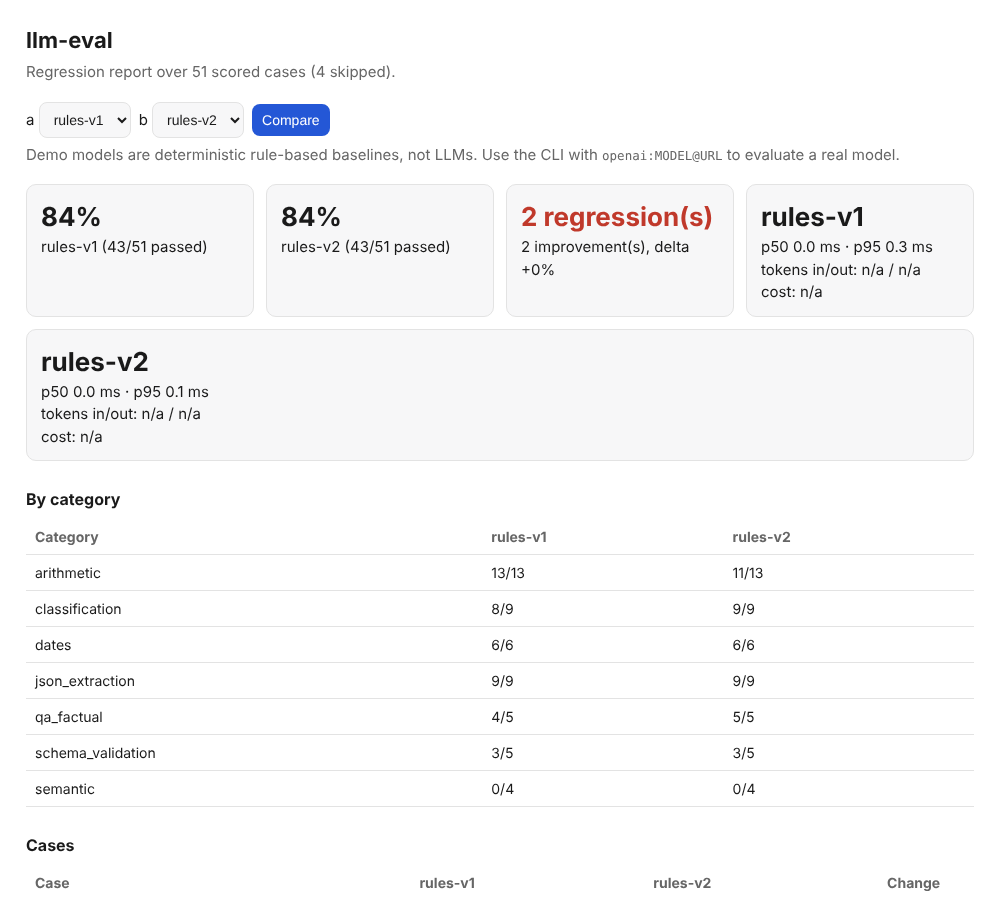

# llm-eval-harness

Regression testing for LLM outputs. Run a model over a categorized suite, score the outputs,
record latency, tokens and cost, compare two runs, and fail CI when something that used to pass
now fails. Works with any OpenAI-compatible endpoint (OpenAI, Ollama, vLLM, LM Studio) or any
Python function.



## Why

A single pass-rate number hides what changed. In the bundled demo, `rules-v1` and `rules-v2` both
score **84%**, yet v2 breaks 2 cases and fixes 2 others. Case-level comparison catches that, and
`llm-eval compare` exits non-zero on any regression, so it works as a CI gate (see
[`examples/github-action.yml`](examples/github-action.yml)).

## Features

- **55-case suite, 8 categories**: arithmetic, classification, JSON extraction, schema validation,
  factual QA, dates, semantic similarity, judged reasoning. Bring your own JSONL suite with `--cases`.
- **Layered scoring**, not just string equality:

| Scorer | Passes when |
| --- | --- |
| `exact_match`, `contains`, `regex`, `number_close` | normalized string / pattern / numeric match |
| `json_equals`, `json_keys` | parsed JSON equals the reference, or has the right keys and types |
| `json_schema` | output validates against a JSON Schema (2020-12) |
| `semantic_similarity` | cosine similarity of embeddings is at least the threshold |
| `llm_judge` | a judge model scores the answer against a rubric (0-10), at least the threshold |

- **Run configuration recorded**: model, `temperature`, `top_p`, `seed`, `max_tokens`, system
  prompt, embedder and judge are stored in each run file.
- **Telemetry**: latency p50 / p95, prompt and completion tokens (from the API's `usage`), and
  cost, plus per-category pass rates in the dashboard.

## Quick start

```bash
pip install -e ".[dev]"
llm-eval-web                       # demo dashboard at http://127.0.0.1:8000
```

The dashboard compares two deterministic **rule-based baselines, not LLMs**; they exist so the demo
and tests are reproducible. The 4 judged cases are skipped (and excluded from totals) unless a
judge is configured.

## Evaluate a real model

```bash
# Local Ollama (no key), with sampling parameters
llm-eval run --model "openai:llama3@http://localhost:11434/v1" \
    --temperature 0 --seed 1 --out llama.json

# Hosted, with cost tracking (prices are USD per 1M tokens, supplied by you)
OPENAI_API_KEY=... llm-eval run --model "openai:gpt-4o-mini" \
    --price-in 0.15 --price-out 0.60 --out gpt.json

# Add an LLM judge for the rubric cases
llm-eval run --model "openai:llama3@http://localhost:11434/v1" \
    --judge "openai:llama3@http://localhost:11434/v1" --out llama.json

llm-eval compare llama.json gpt.json           # exit 1 if anything regressed
llm-eval report llama.json gpt.json -o report.html
```

```bash
# Gemini, through Google's OpenAI-compatible endpoint (key from https://aistudio.google.com/apikey)
GEMINI_API_KEY=... llm-eval run --api-key-env GEMINI_API_KEY \
    --model "openai:gemini-3.1-flash-lite@https://generativelanguage.googleapis.com/v1beta/openai" \
    --out gemini.json
```

Use a current model name from the provider's docs (Gemini 2.5 models are already retired for new
users). Gemini's endpoint rejects `--seed`. The adapter retries 429/5xx responses, but gives up at
once on a daily quota. No price table is built in because prices change; pass them explicitly.

### Live result: `gemini-3.1-flash-lite`

Run on 2026-10-22 on the free tier, `--temperature 0`, the same model as judge (so the judged
cases are self-graded):

| Run | Passed | Notes |
| --- | --- | --- |
| Command above, no system prompt | **41 / 55 (75%)** | latency p50 13.7 s, p95 52.8 s |
| `--system "Reply with only the final answer, no explanation, no markdown."` | **53 / 55 (96%)** | latency p50 14.0 s, p95 94.5 s |

The gap is formatting, not ability. Without a system prompt the model answers `17 + 25 = 42`,
so all 13 arithmetic cases fail `exact_match` (0/13), plus `approx-pi` and `sent-extra-3`
(`Sentiment: Positive`); every other category passes. Pass rates in this table are small-sample
and one run each.

The 96% run predates a fix to `schema-bad-1/2`, whose prompts never asked for JSON, and it
failed exactly those two. The suite now asks for JSON and the no-system-prompt run above (5/5 in
that category) used the fixed suite, but the system-prompt run was not repeated: the model's
free-tier daily quota (20 requests per model per day on the key used, then 429) ran out first.

### Semantic similarity

The default embedder is a dependency-free hashed word and character-trigram model: it measures
lexical and morphological overlap, not deep semantics. For real sentence embeddings:

```bash
pip install sentence-transformers
llm-eval run --model ... --embedder st:all-MiniLM-L6-v2
```

### Calibrating judge and similarity scores (optional, needs PyTorch)

A raw "judge gave 7/10" is not a probability. `llm-eval calibrate` fits a two-parameter logistic
map (Platt scaling, trained with PyTorch) from your scores to the probability that the answer is
actually correct, using **labels you supply**, then reports Expected Calibration Error and the Brier
score on held-out cases before and after.

```bash
pip install -e ".[ml]"
# labels.json: {"case-id": true, "other-id": false, ...}   (your own human judgement)
llm-eval calibrate judged-run.json --labels labels.json --scale 10 --test-fraction 0.3
```

Use `--scale 10` for `llm_judge` scores and `--scale 1` for `semantic_similarity`. The repo ships no
human labels, so the tests exercise the method on **synthetic** scores from a known over-confident
judge; they show the code recovers a known curve, not that any real judge is calibrated. You need
roughly 50+ labelled cases per scorer before the held-out numbers mean much.

## Tests

```bash
python -m pytest        # 55 tests
ruff check src tests
```

Covers every scorer (including attack-style bad JSON and schema violations), the judge prompt
and verdict parsing, percentile and cost math, sampling-parameter and token capture, run
comparison, report HTML escaping, the CLI exit codes, and the web page. The OpenAI-compatible
adapter is tested against a mocked transport, and the CLI was also exercised end to end against a
local fake OpenAI-compatible server.

## Verified vs not verified

- **Verified**: everything above, using mocked and fake HTTP servers.
- **Verified live**: Gemini (`gemini-3.1-flash-lite`, results above). The "no retries" limitation
  below no longer applies to 429/5xx.
- **Not verified**: runs against a live Ollama/vLLM/OpenAI endpoint, and the
  `sentence-transformers` embedder (it needs a model download). Both code paths exist but have not
  been run here.

## Limitations

- Runs are sequential. 429/5xx responses are retried with backoff (up to 5 times, waits over 90 s
  are treated as daily quotas and fail immediately); there is no client-side rate limiting.
- LLM-as-judge quality depends on the judge model; use a different, stronger model than the one
  under test where you can.
- The demo's baselines are toys; results on them say nothing about real model quality.
